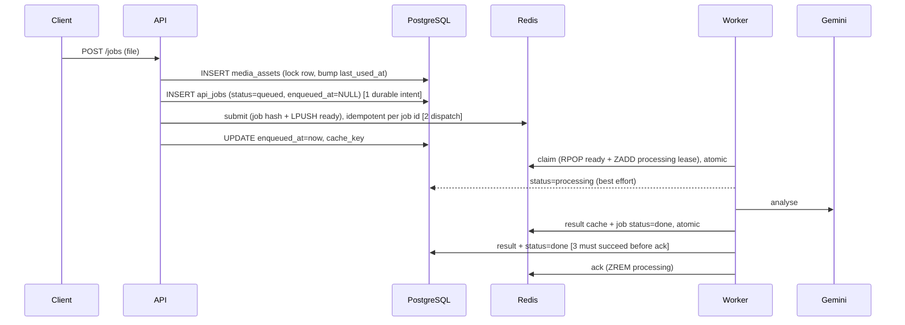

# Job lifecycle across PostgreSQL and Redis

A job lives in two stores that cannot share a transaction:

| Store | Owns | Survives |
|---|---|---|
| **PostgreSQL** `api_jobs` | That the job exists, who owns it, which workspace it belongs to, its final status, error and result, approval and schedule. | Everything. It is the record of truth. |
| **Redis** `ma:*` | Where the job is *right now*: ready list, processing leases, retry schedule, dead letters, dedup and result cache, rate limits. | Usually. It can lose recent writes (failover, `appendfsync everysec`), keys expire by TTL, and someone can flush it. |

This document lists every step that writes to both stores, how each step can fail, and what
repairs it. Each row of the failure matrix names the test that injects that failure.

## The happy path

`api_jobs` is an **outbox**: the row is committed *before* Redis hears about the job, and
`enqueued_at` records that the hand-off happened. Anything committed but not handed off is
found and dispatched later. Nothing the API accepted can be silently lost.

## States

| Status | Where it is set | Meaning |
|---|---|---|
| `queued` | API (row insert), Redis on submit | Waiting for a worker. |
| `waiting` | Redis on submit | Identical media in the same workspace is already in flight; this job reuses its result. |
| `processing` | worker | A worker holds the lease. |
| `retrying` | worker | Transient error or 429; scheduled in `deferred` with backoff. |
| `done` | worker / reconciler | Result stored in both stores. Final. |
| `failed` | worker / reconciler | Not retryable (bad media, blocked content, original gone, lost too often). |
| `dead` | worker | Exhausted `QUEUE_MAX_ATTEMPTS`. Id kept in `ma:dead` for inspection. |
| `cancelled` | API | Cancelled before a worker claimed it. Final. |

The database never moves a job out of `done` or `cancelled` (see `app/api/persistence.py`).

## Who keeps the stores in agreement

1. **The worker's hooks** (`app/api/persistence.py`, wired in `app/api/worker_setup.py`):
   - `on_result` writes the result. It **must** succeed before the job is acked. If PostgreSQL
     is down, the job is re-deferred for one second and the next claim replays the result from
     the Redis cache. Gemini is **not** called again.
   - `on_status` writes `processing` / `retrying` / `failed` / `dead` on a best-effort basis.
     A failure is logged and left to the reconciler.
2. **The reconciler** (`app/api/reconcile.py`) runs every 30 s inside every worker. A Redis lock
   makes sure only one sweep runs at a time, and row locks (`FOR UPDATE SKIP LOCKED`) guard
   each row. It does two sweeps:
   - **Dispatch:** rows with `enqueued_at IS NULL` older than a 60 s grace period are submitted.
   - **Sync:** active rows not updated for 60 s are compared with Redis and repaired, as
     described below.
3. **The reaper** (`ReliableQueue.reap`) puts expired processing leases back on `ready`, so a
   worker that crashed mid-job never strands it.

Run a sweep by hand with `python -m app.cli reconcile`.

## Failure matrix

| # | Failure | State it leaves | Repair | Test (`tests/integration/test_lifecycle.py`) |
|---|---|---|---|---|
| 1 | API dies after committing the row, before Redis | Row `queued`, `enqueued_at NULL`, nothing in Redis | Reconciler dispatch sweep | `test_row_committed_but_never_dispatched_is_dispatched_by_reconciler` |
| 2 | Redis unreachable during upload | Submit raises | Row deleted (compensation), client gets an error; if that delete also fails, case 1 applies | `test_redis_down_during_upload_rolls_the_row_back` |
| 3 | Redis accepted the job, but the `enqueued_at` write was lost | Row `enqueued_at NULL`, job already queued | Re-dispatch is a no-op: `submit_prepared` keeps a per-job `submitted` key, so the job is never enqueued twice | `test_dispatch_is_idempotent_so_a_retried_dispatch_never_double_enqueues` |
| 4 | Worker crashes holding a lease | Id in `processing`, lease expires | Reaper puts it back on `ready` | `test_worker_crash_mid_job_is_reaped_and_finished` |
| 5 | PostgreSQL down when the result is written | Redis `done`, row not `done` | Job re-deferred; replayed from the result cache; acked only after the DB write | `test_result_write_failure_is_retried_without_a_second_gemini_call` |
| 6 | Status hook fails | Row status stale | Ignored by the worker; reconciler sync copies the Redis status | `test_status_hook_failure_never_blocks_processing`, `test_terminal_state_missed_by_the_hooks_is_copied_by_reconciler` |
| 7 | Result never reached the DB at all (hook absent or failed) | Row has no result | Reconciler sync copies the result from Redis | `test_result_missed_by_the_db_is_copied_by_reconciler` |
| 8 | Redis loses the job hash (flush, failover, TTL) | Row active, Redis `unknown` | Reconciler re-submits with `force=True` and increments `recoveries` | `test_job_forgotten_by_redis_is_resubmitted` |
| 9 | Redis loses only the queue entry | Hash says `queued`, id in no structure | Reconciler `requeue_if_lost`: one Lua script checks all four structures and pushes only if the id is in none | `test_queue_entry_lost_while_job_hash_survived_is_requeued` |
| 10 | Redis keeps losing the job | Repeated case 8 | After `max_recoveries` (3) the row becomes `failed` with a clear error, so it never loops forever | `test_recovery_is_bounded` |
| 11 | Original purged or missing at re-dispatch | No media to send | Row becomes `failed` ("upload it again") instead of retrying | `test_job_whose_original_is_gone_fails_cleanly_instead_of_looping` |
| 12 | Several workers reconcile at once | Duplicate sweeps | Redis lock elects one runner per sweep; per-row idempotency covers the rest | `test_only_one_reconciler_runs_a_sweep_at_a_time`, `test_concurrent_reconcilers_dispatch_each_job_once` |

Failures that are not cross-store, such as Gemini errors, rate limits and dedup, are covered by
`tests/integration/test_worker.py`, `test_e2e.py` and `test_jobs.py`.

## Guarantees and their limits

- **No accepted job is lost.** Once `POST /jobs` returns, the job reaches a final status in
  PostgreSQL, provided at least one worker with `DATABASE_URL` set is running.
- **At-least-once processing, mostly-once Gemini calls.** Cases 8 and 9 can hand a job to a
  worker a second time. If the first attempt finished, the second is answered from the result
  cache. Gemini is called twice only if Redis lost the result cache *and* the first attempt
  had already run, which requires real Redis data loss.
- **Bounded staleness.** Without the hooks, PostgreSQL catches up within about one reconcile
  interval plus the grace period (≈90 s by default).
- **Dedup and caching are per workspace.** The cache key is prefixed with the workspace id, so
  tenants never share Gemini results, and a `"cached": true` answer cannot reveal that another
  tenant uploaded the same file.

## Media retention

Originals are deleted by `app/api/retention.py` when **all** of these hold:

- These bytes have not been uploaded by anyone for `MEDIA_RETENTION_DAYS` (default 30; `0`
  disables purging).
- No job using them is still active.
- No scheduled (not cancelled) post using them is still in the future.

Drafts, approvals and calendar entries are kept. After a purge, the media URL answers
**410 Gone**, and uploading the same bytes again restores the original. Upload and purge both
lock the asset row, so an upload can never be paired with an original that is being deleted.
The pruner runs hourly from every worker, or by hand with `python -m app.cli prune-media`.
It also removes `.upload-*` partial files that are more than a day old.

Tests: `tests/integration/test_retention_and_storage.py`.
