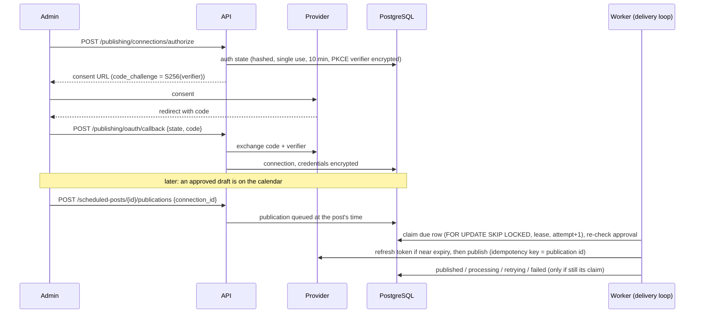

# Publishing

Approved calendar entries can publish themselves at their scheduled time. Every platform sits
behind one provider interface (`app/publishing/base.py`), and the only provider today is the
**sandbox**: a pretend platform inside MediaFlow that behaves like a real one (consent,
expiring tokens, rate limits, asynchronous processing, refusals) without anything leaving the
installation.

A real platform is added only once it passes the [readiness checklist](#adding-a-real-platform)
below. Until then, naming one in `PUBLISHING_PROVIDERS` fails at startup.

## The flow

Delivery state lives in PostgreSQL alone. Publications are few and happen at set times, so a
polled table with leases is simpler and safer than a second queue to keep in step with the
database (compare [JOB_LIFECYCLE.md](JOB_LIFECYCLE.md), where the high-volume job queue needs a
reconciler). The loop runs every 10 seconds in every worker, and row locks make concurrent
workers safe.

## The provider interface

| Method | Purpose | Must |
|---|---|---|
| `authorization_url(state, code_challenge, redirect_uri, options)` | Where the admin consents | Use OAuth 2.0 authorization code with PKCE S256 |
| `exchange_code(code, code_verifier, redirect_uri, options)` | Code → account and credentials | Raise `AuthorizationDenied` on refusal |
| `refresh(credentials)` | New credentials before expiry | Raise `AuthorizationLost` if refused |
| `publish(credentials, payload)` | Send one post | Honour `payload.idempotency_key` if `info.idempotent` |
| `check(credentials, external_id)` | State of a `processing` post | Return `published` once done |
| `revoke(credentials)` | Best effort on disconnect | Never block the disconnect |

`ProviderInfo` declares the channels a provider posts to (which part of a draft it sends:
`instagram`, `facebook`, `tiktok`), whether re-sending after an unknown outcome is safe
(`idempotent`), and any options offered when connecting.

The payload is composed at **send time** from the job's current draft: the channel's caption
or post copy plus its hashtags, or the whole text of a plain-text draft
(`app/publishing/compose.py`). A draft on the calendar can't be edited, so what was approved
is what goes out.

## States

```mermaid
stateDiagram-v2
    [*] --> queued: added to a calendar entry
    queued --> publishing: due; claimed with a lease
    retrying --> publishing: backoff elapsed
    processing --> publishing: time to check
    publishing --> published: platform accepted
    publishing --> processing: accepted, finishing asynchronously
    publishing --> retrying: unavailable or rate limited, attempts left
    publishing --> failed: rejected, authorization lost, or out of attempts
    publishing --> unknown: lease expired and provider not idempotent
    queued --> cancelled: post cancelled, account disconnected, or by hand
    retrying --> cancelled
    failed --> queued: retry by hand
    unknown --> queued: retry by hand, after checking the account
    published --> [*]
```

## Failure handling

The delivery loop decides from the error **type** alone, so every provider must map its
platform's errors onto these. Tests are in `tests/integration/test_publishing.py`.

| Error | Meaning | What happens | Test |
|---|---|---|---|
| `ProviderUnavailable` | 5xx, timeout, connection error | `retrying` with exponential backoff (30 s doubling, cap 30 min, ±20% jitter), up to 5 attempts, then `failed` | `test_transient_failures_retry_with_backoff_then_succeed`, `test_retries_stop_after_max_attempts` |
| `ProviderRateLimited` | 429 / quota | `retrying`, never sooner than the platform's `Retry-After` | `test_rate_limits_wait_at_least_retry_after` |
| `ContentRejected` | Policy, format, length | `failed`, not retried | `test_rejected_content_fails_without_retrying` |
| `AuthorizationLost` | Token revoked, refresh refused, or credentials unreadable after a key change | `failed`; the account becomes `needs_reauth` and retry is refused until it is reconnected | `test_lost_authorization_marks_the_account_for_reconnection`, `test_unreadable_credentials_mean_reconnect` |
| Anything else | A bug or an unmapped library error | Treated as transient, logged with its traceback | (by construction) |

### Crash points

| # | Failure | Result | Test |
|---|---|---|---|
| 1 | Worker dies after the platform accepted, before recording it | Lease expires, the same idempotency key is re-sent, and the platform returns the post it already has. One post, not two | `test_crash_after_the_platform_accepted_never_double_posts` |
| 2 | Same, but the provider can't deduplicate | `unknown` with "check the account first". A person decides, because a double post is worse than a late one | `test_unknown_outcome_on_a_non_idempotent_provider_asks_a_person` |
| 3 | A slow worker returns after another took over | Its result is ignored: outcomes are recorded only by the claim holding the current attempt number | `test_a_worker_that_lost_its_lease_cannot_overwrite_the_outcome` |
| 4 | Two workers see the same due row | `FOR UPDATE SKIP LOCKED`: one claims it, the other moves on | (by construction, as in the reconciler) |

### Checked again at send time

Between scheduling and sending, things change. Just before every attempt, the loop re-checks
and stops cleanly instead of posting stale or unapproved content:

| Condition | Result | Test |
|---|---|---|
| Calendar entry cancelled | `cancelled` (`post_cancelled`) | `test_cancelling_or_rescheduling_the_post_carries_over` |
| Calendar entry rescheduled | Pending deliveries move with it | same |
| Draft no longer approved | `failed` (`not_approved`) | `test_a_draft_that_lost_approval_is_not_sent` |
| Account disconnected or needs reauth | Pending deliveries `cancelled`; due ones `failed` (`connection`) | `test_disconnecting_wipes_credentials_and_cancels_pending_posts` |
| Draft has nothing for the account's channel | Refused when requested (422), `failed` if it happens at send time | `test_requesting_needs_an_approved_scheduled_post_and_matching_content` |

## Security

| Concern | Measure | Test |
|---|---|---|
| Forged or replayed OAuth callbacks | `state` is 256 bits, stored only as SHA-256, single use, expires in 10 minutes, and bound to the admin **and** workspace that started it | `test_authorization_state_is_single_use_bound_and_expiring` |
| Intercepted authorization codes | PKCE S256: the code only works with the verifier that never left the server | `test_a_code_issued_for_another_challenge_fails_pkce`; the S256 function matches RFC 7636's test vector |
| Credentials at rest | Fernet (AES + HMAC) with `PUBLISHING_KEY`, or a key derived from `JWT_SECRET` (HKDF, dedicated label). Never returned by any endpoint | `test_connecting_stores_encrypted_credentials_and_audits` |
| Disconnecting | Best-effort revoke at the provider, then the credentials are wiped; the row stays for history | `test_disconnecting_wipes_credentials_and_cancels_pending_posts` |
| Who can do what | Admins connect and disconnect. A calendar entry's owner, or an admin, chooses where it publishes, retries and cancels. Everything is scoped to the workspace and covered by the cross-tenant sweep | `test_only_the_posts_owner_or_an_admin_can_publish_it`, `tests/integration/test_tenant_isolation.py` |
| Accountability | Connecting, disconnecting, requesting, retrying and cancelling are in the audit trail ([AUDIT.md](AUDIT.md)) | `test_requesting_needs_an_approved_scheduled_post_and_matching_content` |
| Accidental activation | Only implemented providers can be named in `PUBLISHING_PROVIDERS`; `none` turns publishing off | `test_only_implemented_providers_can_be_enabled`, `test_publishing_can_be_switched_off` |

## The sandbox

Connect an account from **Publishing** (admins), pick the channel it posts and what it should
simulate, and approve the sandbox's consent screen. Then open a calendar entry and choose
**Publish at this time**.

| Behaviour | What the sandbox does | Shows |
|---|---|---|
| `succeed` | Publishes at once | The happy path |
| `flaky` | 503 twice, then publishes | Retry with backoff |
| `rate_limited` | 429 with `Retry-After` once, then publishes | Honouring rate limits |
| `processing` | Accepts as processing; done on the next check | Asynchronous delivery |
| `reject` | Refuses for (pretend) policy | Permanent failure |
| `expire` | Issues an already-expired token and refuses refresh | Reconnect flow |

The Publishing page also shows the sandbox's side: what it "published" and every request it
received (`503`, `429`, `duplicate`, ...), as a real platform's developer console would.

## Adding a real platform

Add **one** platform, and only once each item below has an owner and an answer written down.
The sandbox already exercises the shape of each; the work is proving the real platform fits.

1. **Approval.** The platform's app review is approved for exactly the scopes needed, and the
   use case on file matches the product (scheduled posting of human-approved drafts).
2. **OAuth specifics.** Authorization and token endpoints, PKCE support (or why not), scopes,
   access and refresh token lifetimes, and whether refresh tokens rotate. A server-side
   redirect route at `PUBLIC_BASE_URL` that hands `state` and `code` to `#/publishing/callback`.
   The revoke endpoint.
3. **Error mapping.** A table from the platform's real error responses (status codes, error
   codes, quota headers) to the four error types, backed by recorded fixtures in contract
   tests.
4. **Idempotency.** Whether the platform deduplicates a retried request, or a way to look a
   post up by our key. If neither exists, `idempotent=False`, and crash point 2 applies.
5. **Rate limits.** Per app, per account and per day, and how the platform reports them.
6. **Media.** Upload by URL or by bytes, size and format limits, and whether the media needs
   a public URL (and how long it must stay up).
7. **Asynchronous publishing.** How processing status is polled (or delivered by webhook,
   which then needs signature verification).
8. **Testing.** Contract tests against recorded responses run in CI. A run against the
   platform's own test or sandbox account is done by hand before enabling.
9. **Operating it.** An alert on its failure ratio from `mediaflow_publish_outcomes_total`, a
   runbook entry, and the kill switch (remove it from `PUBLISHING_PROVIDERS`).
10. **Data.** What the platform's terms require on stored tokens and post data, and deletion
    when an account is disconnected or a workspace leaves.

## Operating

- Metric: `mediaflow_publish_outcomes_total{provider,outcome}` (bounded labels: provider name,
  outcome code).
- Logs carry `publication_id` and the error `code`.
- `unknown` publications need a person. Check the account on the platform: if the post is
  there, cancel ours; if not, retry.
