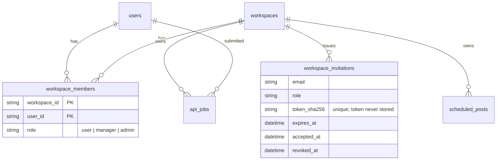
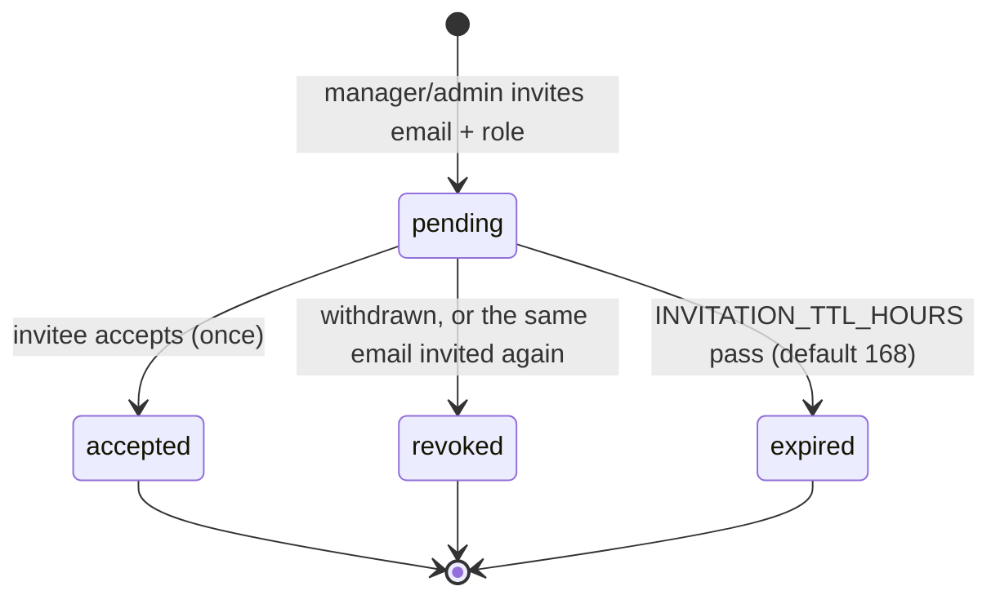

# Tenancy: workspaces, memberships and invitations

A **workspace** is the tenant: one team, brand or client. It is the boundary for data,
permissions, deduplication and caching. A person has one **account** (email + password) and
any number of **memberships**, with a separate role in each workspace.

## How a request finds its tenant

1. The bearer token identifies the **account** (`users.id` plus `token_version`, so a password
   change signs the person out everywhere).
2. `X-Workspace-Id` picks the workspace; without it, the person's oldest membership is used.
3. `current_member` (`app/api/dependencies.py`) loads the membership. No membership means
   `403`. The result, a `Member` with `workspace_id` and the **role in that workspace**, is the
   only thing route handlers use for scoping and permission checks.

Every tenant-owned query filters on `workspace_id`, and a row from another workspace answers
`404`, never `403`, so ids can't be probed to learn what exists. The job cache key starts with
the workspace id, so identical uploads in two tenants never share a Gemini call or reveal each
other through `"cached": true`.

## Roles

Roles live on the membership, so the same person can be an admin in one workspace and a member
in another.

| | Member (`user`) | Manager | Admin |
|---|:-:|:-:|:-:|
| Upload, see and schedule own jobs | ✓ | ✓ | ✓ |
| Review (approve / reject) drafts | | ✓ | ✓ |
| Invite or create members and managers | | ✓ | ✓ |
| Invite, create or withdraw admins | | | ✓ |
| List, edit and remove people; see all jobs and stats | | | ✓ |
| Rename the workspace | | | ✓ |

Rules that protect a tenant:

- **A workspace always keeps an admin.** The last admin can't be demoted, removed, or leave.
- **No tenant can take over a shared account.** An admin may change someone's email or password
  only if that account belongs to no other workspace.
- **Joining a second workspace needs consent.** `POST /users` refuses an email that already has
  an account; the only way in is an invitation the person accepts while signed in.
- **Platform roles are separate.** `users.role` (`admin`) is for operating the installation
  (fleet stats, creating workspaces when sign-up is closed). The protected super-admin account
  can't be modified through the API.

## Invitations

| Step | Endpoint | Who |
|---|---|---|
| Invite | `POST /invitations {email, role}` → `201` with `token` and `accept_path` (`/#/invite/<token>`) | Manager or admin of the current workspace |
| List pending | `GET /invitations` | Manager or admin |
| Withdraw | `DELETE /invitations/{id}` | Manager or admin (admin invitations: admin only) |
| Preview | `POST /invitations/lookup {token}` → workspace name, email, role, expiry, `account_exists` | Anyone with the link |
| Accept | `POST /invitations/accept {token, password?}` → access token + workspace | The invited person |

Accepting has two paths:

- **New to MediaFlow** (`account_exists: false`): the request carries the password the invitee
  chooses. The account and the membership are created together. Unlike `POST /users`, the
  inviter never knows the password.
- **Existing account:** the invitee must be **signed in as the invited email**. An anonymous
  accept answers `409` ("sign in to accept"), and a different signed-in account answers `403`,
  so a leaked link can't attach someone else's account or set a password on it.

Security properties, each with a test in `tests/integration/test_invitations.py`:

| Property | How |
|---|---|
| Tokens can't be guessed | `secrets.token_urlsafe(32)`, 256 bits |
| A database leak doesn't leak working links | Only `sha256(token)` is stored, under a unique index |
| Tokens stay out of logs | They travel in request bodies (`lookup`, `accept`) and in the URL **fragment** of the link, which browsers never send to a server |
| Single use, even when two accepts race | `UPDATE … SET accepted_at WHERE id = ? AND accepted_at IS NULL AND revoked_at IS NULL AND expires_at > now()`. Only one request can match; the other gets `410` and adds nothing |
| One live link per person and workspace | Inviting the same email again revokes the earlier link |
| Invitations stay inside their tenant | Listing and withdrawing are scoped to the caller's workspace (`404` otherwise) |
| Expiry | `INVITATION_TTL_HOURS` (1–720, default 168) |

MediaFlow sends no email. The inviter copies the link from the Team page and shares it through
their own channel. Whoever holds a link for a **new** email can create that account, which is
the same trust as `POST /users` today, but the password stays private to the invitee.

## Leaving and removing

- `POST /workspaces/{id}/leave`: the caller leaves. Refused for your only workspace, or if you
  are its last admin. **Work stays with the workspace:** jobs, drafts and calendar entries remain
  visible to its admins.
- `DELETE /users/{id}` (admin): removes the person **and their jobs in this workspace**. The
  account itself is deleted only if it belongs to no other workspace.
- Deleting an inviter keeps their pending invitations valid (`invited_by` becomes `NULL`).

## Proof and history

- `tests/integration/test_tenant_isolation.py` tries every id-taking route as three outsiders
  (another workspace's admin, a platform admin, a member), with valid payloads and a spoofed
  `X-Workspace-Id`. Each attempt must be refused, leak nothing, and leave the target workspace
  byte-for-byte unchanged, while the same request from an insider succeeds. A guard test fails
  if a new route isn't classified there.
- Every membership, role, invitation, review and calendar change is in the audit trail
  ([AUDIT.md](AUDIT.md)).

## What is not here yet

- Per-workspace quotas or billing; the Gemini rate limit is shared by the installation.
- Email delivery of invitations.
- An organization level above workspaces. Today one organization is one workspace; a person who
  works for several clients holds one membership per client workspace.
